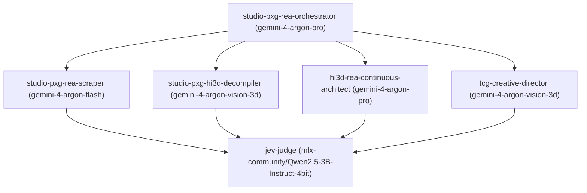

# Studio PxG - LumenForge.io REA Plugin (`studio-pxg-lumenforge-rea`)

> **Studio Brand**: Studio PxG - LumenForge.io  
> **Plugin ID**: `studio-pxg-lumenforge-rea`  
> **Version**: `1.0.0`  
> **Primary Swarm Model**: `gemini-4-argon`

## Overview

The **Studio PxG - LumenForge.io Reverse Engineer Anything (REA)** plugin provides a deterministic, multi-agent reconstruction and harvesting pipeline for **CARDFRONT: Cradle of Echoes** and **LumenForge.io**. It unifies binary decompilation (Mach-O / IL2CPP), 3D mesh and Unity URP shader extraction, WebGL/DOM bundle reconciliation, and TCG collector catalog harvesting under a single sovereign swarm architecture.

---

## Architecture & Swarm Routing (`gemini-4-argon`)

Workloads are decomposed by the master orchestrator and routed across specialized model tiers with automatic local Apple Silicon Metal GPU fallback:



### Swarm Model Configuration

| Tier Role | Model Identifier | Target Workload |
| :--- | :--- | :--- |
| `primary_model` | `gemini-4-argon` | Default sovereign swarm routing baseline |
| `orchestrator` | `gemini-4-argon-pro` | Multi-agent task decomposition, call-graph synthesis, and architectural reconstruction |
| `worker_swarm` | `gemini-4-argon-flash` | High-throughput parallel catalog scraping, DOM reconciliation, and symbol harvesting |
| `vision_3d_rea` | `gemini-4-argon-vision-3d` | 3D GLB/OBJ topology auditing, multi-angle elevation analysis, and 600x800 TCG portrait verification |
| `local_apple_silicon_fallback` | `mlx-community/Qwen2.5-3B-Instruct-4bit` | 100% offline Apple Silicon Metal GPU (`jevmlx`) verification gates and bounded schema decisions |

---

## REA Tool Suite (`rea_tools`)

1. **`rea_binary_macho_il2cpp_inspector`**: Inspects Mach-O universal binaries, parses IL2CPP `global-metadata.dat`, resolves native-to-managed boundaries, and reconstructs C# assembly definitions.
2. **`rea_3d_topology_shader_decompiler`**: Audits 3D GLB/OBJ manifold topology, extracts multi-view orthographic silhouettes, and decompiles GPU shader objects into Unity URP ShaderLab/HLSL source.
3. **`rea_tcg_catalog_scraper_harvester`**: Harvests structured TCG card sets, rarity metadata, directional grid rules, and normalized `600x800` card art with cryptographic provenance ledgers.
4. **`rea_web_bundle_dom_reconciler`**: Deconstructs WebGL/JavaScript bundles, traces module imports, observes live DOM/runtime transitions, and emits strongly typed bridge contracts.
5. **`rea_plugin_mcp_registry_builder`**: Generates and validates MCP tool schemas, subagent manifests, and code-native `256x256` SVG capability badges.
6. **`rea_obligation_ledger_verifier`**: Enforces 100% reconstruction obligation coverage before completion using `jev_gate` and `mlx_jev_judge`.

---

## Specialist Subagents (`subagents`)

- **`studio-pxg-rea-orchestrator`**: Master coordinator for parallel REA workstreams.
- **`studio-pxg-rea-scraper`**: High-concurrency catalog, bundle, and symbol harvester.
- **`studio-pxg-hi3d-decompiler`**: 3D mesh topology and URP shader reconstruction specialist.
- **`hi3d-rea-continuous-architect`**: Continuous integration architect bridging decompiled assets into Unity TCG Engine assemblies.
- **`tcg-creative-director`**: Enforces Atelier art direction, `600x800` portrait framing, `1024x768` stage contrast (`<= 0.20` RMS), and `256x256` SVG faction crests.
- **`jev-judge`**: Pre-completion verification gatekeeper powered by Jev System One and local Apple Silicon MLX inference.

---

## Built-in Scrapers (`scrapers`)

- `pxg_shadowverse_evolve_bp05_scraper`: Harvests expansion set metadata, card stats, and reference portraits for BP05 catalog parity.
- `pxg_hi3d_topology_harvester`: Extracts watertight 3D GLB/OBJ meshes, vertex attributes, and UV layouts.
- `pxg_urp_shader_extractor`: Recovers Unity Universal Render Pipeline (URP) surface parameters, foil/hologram passes, and material property blocks.
- `pxg_macho_il2cpp_symbol_scraper`: Extracts Mach-O symbol tables, Objective-C/Swift metadata, and IL2CPP method pointers.

---

## CLI Usage

```bash
# Validate the Studio PxG REA plugin manifest and MCP registry
python3 Tools/rea/plugin_mcp_registry_builder.py \
  --manifest Plugins/studio-pxg-lumenforge-rea/plugin.json \
  --verify

# Run parallel TCG catalog and 3D topology harvesting under gemini-4-argon
python3 Tools/rea/tcg_catalog_scraper_harvester.py \
  --scraper pxg_shadowverse_evolve_bp05_scraper \
  --model gemini-4-argon-flash \
  --parallel

# Decompile Mach-O / IL2CPP binary targets and verify reconstruction ledger
python3 Tools/rea/binary_macho_il2cpp_inspector.py \
  --binary Build/macOS/Cardfront.app/Contents/MacOS/Cardfront \
  --metadata Build/macOS/Cardfront.app/Contents/Resources/Data/il2cpp_data/Metadata/global-metadata.dat

# Gate reconstruction coverage via local Apple Silicon MLX fallback
python3 Tools/rea/obligation_ledger_verifier.py \
  --plugin Plugins/studio-pxg-lumenforge-rea/plugin.json \
  --fallback-model mlx-community/Qwen2.5-3B-Instruct-4bit
```
